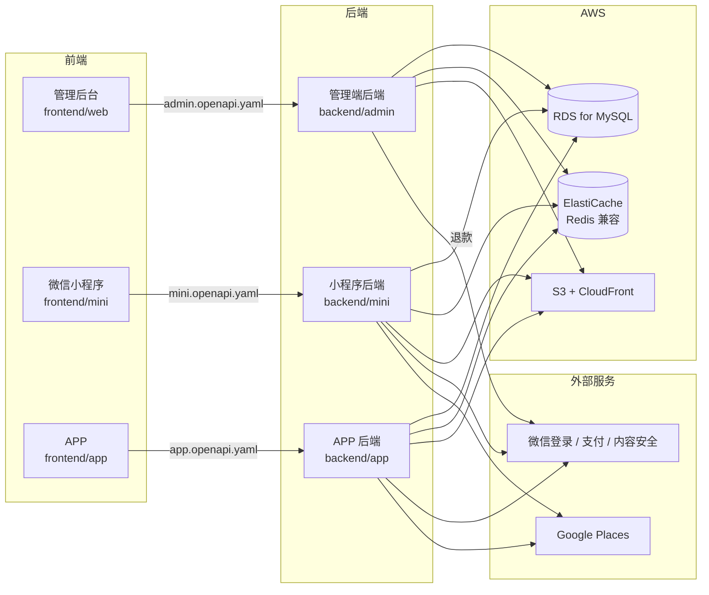

# 拾澳 PickAus · 架构设计

本文件描述拾澳的整体架构：由哪些部分组成、它们之间怎么协作、按什么顺序开发。

具体规则见各级 `AGENTS.md`；接口约定见 `docs/api/conventions.md`；重要决策的来龙去脉见 `docs/adr/`。

---

## 1. 产品与阶段

拾澳（PickAus）是面向澳洲华人社区的同城电商，包含两部分：

- **商城**：店铺自营商品，线下配送或快递。
- **闲置**：用户发布二手物品，平台不经手交易，只撮合联系方式。

| 端 | 使用者 | 状态 |
| --- | --- | --- |
| 管理后台（网页） | 店员 | **当前阶段：前端开发** |
| 微信小程序 | 顾客 | 待开发 |
| APP | 顾客 | 未来规划 |

## 2. 系统组成

**每一个前端只和自己对应的后端通信**，通信的约定就是该端的接口契约。三个后端共用一个数据库。

云服务统一使用 **AWS**，部署在悉尼区域（`ap-southeast-2`），靠近用户，数据也留在澳洲境内。图片由前端通过预签名地址直接上传到 S3，不经过后端中转。

## 3. 仓库与工程

仓库内有 6 个**完全独立**的工程，只是暂时放在同一个仓库里：

| 目录 | 工程 | 技术栈 |
| --- | --- | --- |
| `frontend/web` | 管理后台前端 | Vue 3 + Vite + TypeScript + Element Plus + Pinia |
| `frontend/mini` | 微信小程序 | Uniapp（CLI 版）+ Vue 3 + TypeScript + Pinia |
| `frontend/app` | APP（占位） | Uniapp |
| `backend/admin` | 管理端后端 | Go + Gin + GORM |
| `backend/mini` | 小程序后端 | Go + Gin + GORM |
| `backend/app` | APP 后端（占位） | Go + Gin + GORM |

### 独立性原则

- 每个工程有自己的依赖、配置、构建方式和部署单元，**单独拿出来就能开发和部署**。
- 工程之间**不共享任何代码**，不互相引用。需要相同的工具函数或业务规则时，各自实现一份。
- 工程之间只通过两样东西发生关系：**接口契约**（前端与后端之间）和**数据库**（后端与后端之间）。

以后业务壮大，任何一个工程都可以直接拆成独立仓库或独立服务，代码不需要修改。原因和代价见 `docs/adr/0001-project-structure.md`。

### 工程之间的关系

| 关系 | 通过什么 | 说明 |
| --- | --- | --- |
| 前端 ↔ 对应的后端 | 接口契约 `docs/api/*.openapi.yaml` | 契约是唯一的约定。前端不看后端代码，后端不看前端代码 |
| 后端 ↔ 后端 | 共用的 MySQL | 每张表由哪一端写入、哪一端只读，在表设计阶段写进 `docs/sql/table-owners.md` |
| 支付回调 | 由发起支付的那一端处理 | 小程序订单的回调归 `backend/mini` |
| 定时任务 | 各端只处理本端来源的订单 | 例如超时未支付的取消、时段结束 24 小时后的自动完成 |

### 业务规则在多个工程中的一致性

订单状态、库存锁定、退款规则，会同时出现在管理端后端和小程序后端中。工程不共享代码，就必须靠以下方式保证两边一致：

1. 规则只在 PRD 和 `docs/design/` 中定义一次，两边都照此实现。
2. 两边都要为这些规则编写测试，测试用例按 PRD 逐条对应。
3. 修改规则时，在同一个任务中同时修改两边。

## 4. 技术选型

| 领域 | 选型 |
| --- | --- |
| 管理后台前端 | Vue 3、Vite、TypeScript、Element Plus、Pinia、Vue Router、axios |
| 小程序前端 | Uniapp（CLI 版）、Vue 3、TypeScript、Pinia |
| 接口类型生成 | openapi-typescript |
| 前端模拟接口 | MSW（管理后台）；请求层切换（小程序，因小程序不支持 Service Worker） |
| 前端测试 | Vitest、Vue Test Utils |
| 后端 | Go、Gin、GORM、Viper、Zap |
| 云服务 | AWS，悉尼区域 `ap-southeast-2` |
| 数据库 | MySQL 8.0+，使用 Amazon RDS for MySQL |
| 缓存 | Redis 兼容的 Amazon ElastiCache，客户端 go-redis v9 |
| 对象存储 | Amazon S3，前端通过预签名地址直传；经 CloudFront 分发 |
| 包管理 | pnpm（前端）、Go Modules（后端） |
| 代码托管与 CI | GitHub、GitHub Actions |
| AI 编码工具 | Claude Code、Codex，共用 `AGENTS.md` 和 `.agents/skills/` |

## 5. 关键设计约定

以下约定贯穿所有工程，详细规则见对应文件：

| 约定 | 要点 | 详见 |
| --- | --- | --- |
| 契约先行 | 先改契约，再改前后端代码 | `docs/adr/0003-contract-first.md` |
| ID | 雪花算法生成，接口中用字符串传输 | `docs/api/conventions.md` |
| 金额 | 整数，单位为澳元分，字段名以 `Cents` 结尾 | `docs/api/conventions.md` |
| 时间 | 接口统一返回 UTC，前端按城市时区显示 | `docs/api/conventions.md` |
| 双语 | 商品、类目、城市等数据存中英两份，字段后缀 `Zh` / `En` | `docs/api/conventions.md` |
| 快照 | 订单中的商品名、价格、运费、地址都在下单时抄下，之后不变 | `docs/design/admin-data-dictionary.md` |
| 并发控制 | 不使用数据库锁；状态变更用带旧状态条件的 UPDATE，编辑用乐观锁 | 后端工程的 `AGENTS.md` |
| 缓存 | 每个 key 都有过期时间，且加随机值防止同时失效 | 后端工程的 `AGENTS.md` |
| 隐私 | 管理后台看不到任何用户的手机号和微信号 | `docs/design/admin-data-dictionary.md` |
| 身份隔离 | 管理员与顾客的 token 互不通用 | `docs/api/conventions.md` |

## 6. 开发阶段

| 阶段 | 内容 | 产出 |
| --- | --- | --- |
| 0. 规则 | 仓库设置、AI 规则、协作流程、设计文档 | 本仓库现有的规则文件 ✅ |
| 1. 管理后台前端 | 接口契约 → 工程骨架 → 城市示例模块 → 其余业务模块并行 | `admin.openapi.yaml`、`frontend/web` |
| 2. 表设计 | 以字段清单为基础设计全部表结构 | `docs/sql/schema.sql`、`docs/sql/table-owners.md` |
| 3. 小程序前端 | 小程序契约、UI 设计稿、页面开发 | `mini.openapi.yaml`、`frontend/mini` |
| 4. 后端 | 管理端后端、小程序后端，按契约实现 | `backend/admin`、`backend/mini` |
| 5. 联调与上线 | 前端关闭模拟数据，连接真实后端 | 测试环境、生产环境 |
| 以后 | APP | `frontend/app`、`backend/app` |

阶段 1 的任务和负责人见 `docs/tasks/admin-web.md`。

### 为什么前端可以先于后端开发

接口契约定下来之后，前端用按契约编写的模拟数据开发；后端完成后，关闭模拟即可对接，页面代码不需要修改。详见 `docs/adr/0003-contract-first.md`。

## 7. 部署（规划）

具体方案在阶段 4、5 确定，原则如下：

- 全部部署在 AWS 悉尼区域（`ap-southeast-2`）。
- 每个工程独立构建、独立部署。管理后台前端构建为静态文件，放在 S3，经 CloudFront 分发；后端构建为容器镜像，具体的运行服务（如 ECS、App Runner）在阶段 4 确定。
- 环境分为**测试环境**和**生产环境**：develop 分支自动部署到测试环境；打了发布 tag 的版本部署到生产环境。
- 发布 tag 按工程区分，格式为 `范围/v版本号`，如 `fe-web/v0.1.0`。
- 数据库密码、微信支付证书等密钥存放在 AWS Secrets Manager，不进入代码仓库。
- GitHub Actions 通过 OIDC 获取临时的 AWS 权限进行部署，不在 GitHub 中保存长期有效的 AWS 访问密钥。

## 8. 文档索引

| 文档 | 内容 |
| --- | --- |
| `docs/prd/` | 需求文档 |
| `docs/prototype/` | 产品原型 |
| `docs/design/admin-data-dictionary.md` | 管理端字段清单 |
| `docs/api/conventions.md` | 接口通用约定 |
| `docs/api/*.openapi.yaml` | 各端接口契约 |
| `docs/adr/` | 架构决策记录 |
| `docs/tasks/` | 任务清单与锁定目录 |
| `AGENTS.md`、各工程的 `AGENTS.md` | 规则 |
| `CONTRIBUTING.md` | 协作流程 |
