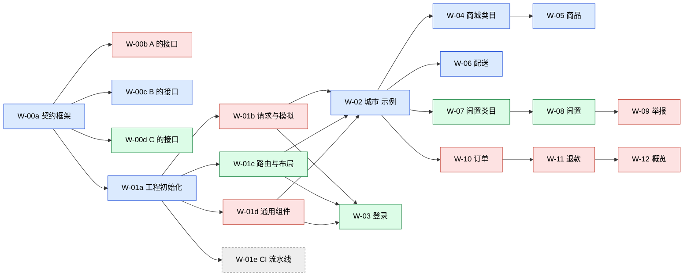

# 管理后台前端任务清单（frontend/web）

本文件记录每个任务的**范围、依赖和负责人**。

**任务的状态和计划日期，在 GitHub Project 看板「拾澳 · 管理后台前端」上查看和修改。** 仓库页面顶部的 **Projects** 标签可以进入看板。使用方法见 `docs/tasks/github-project-guide.md`。

## 成员

| 代号 | GitHub | 业务模块 |
| --- | --- | --- |
| A | @RealninX | 概览、订单、退款、举报 |
| B | @MoonLight-QAQ | 城市、商城类目、商品、配送 |
| C | @celine-hy | 登录、闲置类目、闲置 |

接口契约、工程骨架和共享区域由三人共同完成，拆成若干子任务，每个子任务有一位明确的负责人。

## 依赖图

箭头表示「完成后才能开始」。颜色表示负责人。

🟥 A @RealninX　🟦 B @MoonLight-QAQ　🟩 C @celine-hy　⬜ 待分配

**W-02 城市是示例模块**，其他人照着它的写法开发。W-02 合并后，其余业务模块可以并行。

## 一、接口契约

所有子任务都修改同一个文件 `docs/api/admin.openapi.yaml`。为减少冲突：W-00a 先搭好文件结构，并为每个人预留各自的区块；之后每人只在自己的区块内添加内容。

| ID | 内容 | 范围 | 负责人 | 依赖 |
| --- | --- | --- | --- | --- |
| W-00a | 契约框架：文件结构，以及通用响应、错误、分页、ID、金额、时间、图片、双语字段等公共定义 | 契约中的公共部分 | @MoonLight-QAQ | — |
| W-00b | A 的模块接口：概览、订单、退款、举报 | 契约中 A 的区块 | @RealninX | W-00a |
| W-00c | B 的模块接口：城市、商城类目、商品、配送、图片上传 | 契约中 B 的区块 | @MoonLight-QAQ | W-00a |
| W-00d | C 的模块接口：登录、闲置类目、闲置 | 契约中 C 的区块 | @celine-hy | W-00a |

## 二、工程骨架与共享区域

以下路径都位于 `frontend/web/` 下，W-01e 除外。

| ID | 内容 | 范围 | 负责人 | 依赖 |
| --- | --- | --- | --- | --- |
| W-01a | 工程初始化：依赖、构建、lint、测试、类型检查等配置；应用入口；全局样式 | 工程根目录下的配置文件、`src/main.ts`、`src/App.vue`、`src/styles/` | @MoonLight-QAQ | W-00a |
| W-01b | 请求与模拟：请求封装、从契约生成类型、模拟接口的基础设施、错误码常量 | `src/api/http.ts`、`src/api/generated/`、`src/mocks/browser.ts`、`src/mocks/handlers/index.ts`、`src/constants/`、`src/types/` | @RealninX | W-01a |
| W-01c | 路由、布局与登录状态 | `src/router/`、`src/layouts/`、`src/stores/` | @celine-hy | W-01a |
| W-01d | 通用组件与工具，以及它们的单元测试 | `src/components/`、`src/composables/`、`src/utils/` | @RealninX | W-01a |
| W-01e | CI 流水线：前端检查、PR 来源分支检查、锁定目录检查、依赖更新 | 仓库根目录下的 `.github/workflows/`、`.github/dependabot.yml`、`.github/repo-settings/` | **待分配** | W-01a |

## 三、业务模块

以下路径都位于 `frontend/web/` 下。每个模块还包括 `src/router/index.ts` 中属于该模块的路由。

| ID | 模块 | 范围 | 负责人 | 依赖 |
| --- | --- | --- | --- | --- |
| W-02 | 城市（示例模块） | `src/views/city/`、`src/api/city.ts`、`src/mocks/handlers/city.ts`、`src/mocks/data/city.ts` | @MoonLight-QAQ | W-01b、W-01c、W-01d |
| W-03 | 登录 | `src/views/login/`、`src/api/auth.ts`、`src/mocks/handlers/auth.ts`、`src/mocks/data/auth.ts` | @celine-hy | W-01b、W-01c、W-01d |
| W-04 | 商城类目 | `src/views/mall-category/`、`src/api/mall-category.ts`、`src/mocks/handlers/mall-category.ts`、`src/mocks/data/mall-category.ts` | @MoonLight-QAQ | W-02 |
| W-05 | 商品（列表、新增、编辑、入库） | `src/views/product/`、`src/api/product.ts`、`src/mocks/handlers/product.ts`、`src/mocks/data/product.ts` | @MoonLight-QAQ | W-04 |
| W-06 | 配送（费用、时段、区与 suburb） | `src/views/delivery/`、`src/api/delivery.ts`、`src/mocks/handlers/delivery.ts`、`src/mocks/data/delivery.ts` | @MoonLight-QAQ | W-02 |
| W-07 | 闲置类目 | `src/views/flea-category/`、`src/api/flea-category.ts`、`src/mocks/handlers/flea-category.ts`、`src/mocks/data/flea-category.ts` | @celine-hy | W-02 |
| W-08 | 闲置（封面墙、详情、已浏览、强制下架） | `src/views/listing/`、`src/api/listing.ts`、`src/mocks/handlers/listing.ts`、`src/mocks/data/listing.ts` | @celine-hy | W-07 |
| W-09 | 举报（列表、忽略、下架） | `src/views/report/`、`src/api/report.ts`、`src/mocks/handlers/report.ts`、`src/mocks/data/report.ts` | @RealninX | W-08 |
| W-10 | 订单（列表、详情、开始配送、标记送达） | `src/views/order/`、`src/api/order.ts`、`src/mocks/handlers/order.ts`、`src/mocks/data/order.ts` | @RealninX | W-02 |
| W-11 | 退款（列表、详情、同意、拒绝） | `src/views/refund/`、`src/api/refund.ts`、`src/mocks/handlers/refund.ts`、`src/mocks/data/refund.ts` | @RealninX | W-10 |
| W-12 | 概览 | `src/views/dashboard/`、`src/api/dashboard.ts`、`src/mocks/handlers/dashboard.ts`、`src/mocks/data/dashboard.ts` | @RealninX | W-10、W-11 |

## 工作量

| 成员 | 契约 | 骨架 | 业务模块 |
| --- | --- | --- | --- |
| A @RealninX | W-00b | W-01b、W-01d | W-09、W-10、W-11、W-12 |
| B @MoonLight-QAQ | W-00a、W-00c | W-01a | W-02、W-04、W-05、W-06 |
| C @celine-hy | W-00d | W-01c | W-03、W-07、W-08 |
| 待分配 | — | W-01e | — |

## 修改本文件

- 新增、取消任务，调整范围或依赖，变更负责人时，**先在 GitHub 上修改 issue，再修改本文件**，通过 PR 提交。必要时更新 `.github/CODEOWNERS`。
- 任务的状态和日期**不写在这里**，以看板为准。
- 具体做法见 `docs/tasks/github-project-guide.md` 第三部分的「维护任务」。
